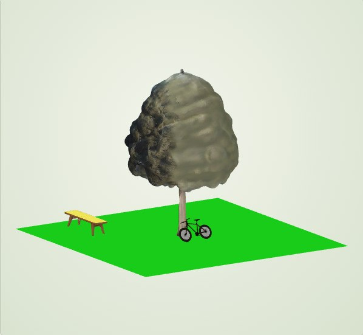

# PhiP-G Demo

**[Launch the interactive demo](https://qixuanwang-233.github.io/phip-g-demo/)** · [Explore the scene gallery](https://qixuanwang-233.github.io/phip-g-demo/#gallery) · [Download the offline package](https://qixuanwang-233.github.io/phip-g-demo/PhiP-G-demo.zip)

*PhiP-G: Physics-Guided Text-to-3D Compositional Scene Generation*

On the demo homepage, drag to orbit the live scene, rerun the layout, or download the textured GLB. The gallery below the live demo offers turntable views of three archived results.

## Review release

During peer review, our laboratory’s confidentiality requirements apply to the complete internal prompt logs and raw model outputs. We are providing a runnable test demo and an interactive gallery at this stage. As stated in our response to the reviewers, we plan to release the complete prompts and model outputs together with the code after acceptance.

## What runs

The test uses one fixed description and four cached meshes. It computes object placement and contact corrections, then exports the assembled scene. Text interpretation, asset generation and iterative visual supervision are outside the scope of this release.

## Run offline

Extract the download and open `index.html` in a modern browser. Alternatively, use Node.js 18 or newer and run `node layout.js` to write `phip-g-scene.glb` in the current directory.

| File | Purpose |
|---|---|
| `index.html` | Interactive homepage with the live demo and gallery |
| `gallery.html` | Standalone multi-view gallery |
| `demo/` | Browser and command-line test package |
| `PhiP-G-demo.zip` | Offline download |
